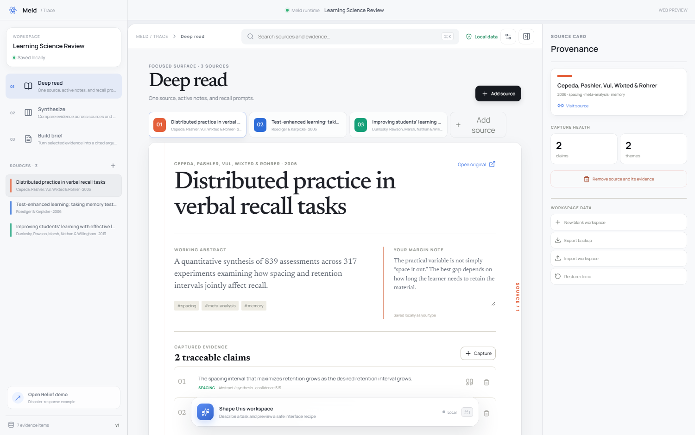
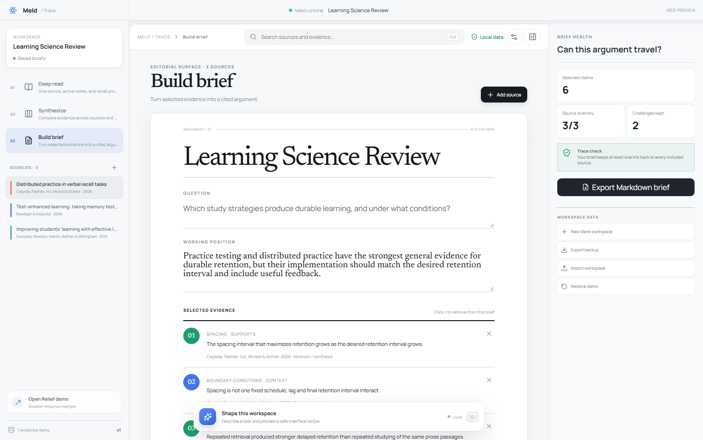
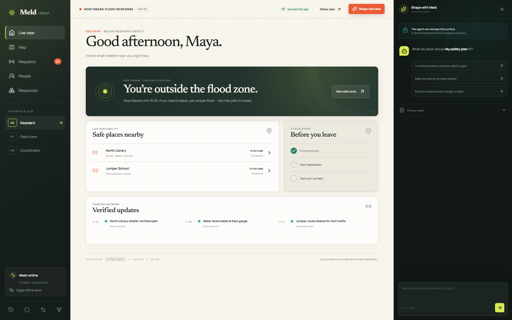
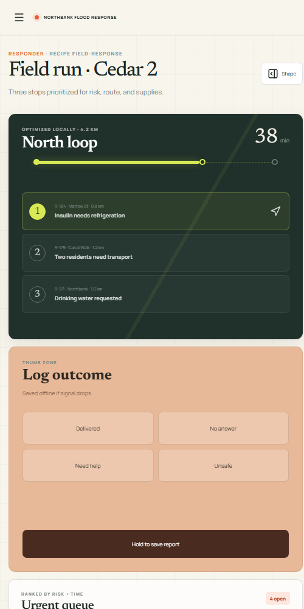

# Meld

### Software should fit the situation — not the other way around.

Meld is an experimental runtime for **agent-editable software interfaces**. Applications publish a stable set of capabilities and policies; a user or coding agent composes those primitives into radically different, reversible interfaces.

This repository now includes two complete applications:

- **Trace** — a usable, local-first evidence workspace for study, research, product discovery, and decision briefs.
- **Relief** — a reference application where one shared disaster-response stream becomes radically different surfaces for residents, field crews, and coordinators.


> **Status:** usable web and Electron desktop application. Trace supports persistent workspaces, source and evidence capture, synthesis, brief authoring, safe AI reshaping, JSON import/export, and cited Markdown export. The core app works offline; an API key is optional.

## Trace: a practical application

Trace addresses a common failure in knowledge work: notes become disconnected from their sources, comparisons happen in improvised spreadsheets, and final conclusions lose their evidential boundary.

The same evidence store becomes three purpose-built interfaces:

| Intent | Surface | What it does |
| --- | --- | --- |
| Understand | **Deep read** | focuses one source, keeps margin notes, exposes atomic evidence, and prompts active recall |
| Compare | **Synthesize** | lays sources against themes, reveals contradictions, and measures coverage gaps |
| Communicate | **Build brief** | turns selected evidence into an editable argument and cited Markdown document |

Everything is stored locally. You can create a blank workspace, add or remove sources, capture and classify evidence, select what enters the argument, back up the full workspace as JSON, and import it on another device.

See the [Trace user guide](docs/trace-guide.md) for the complete workflow and data/privacy boundaries.

<p align="center">
  
  
</p>

## Why Meld exists

Most generative UI projects ask an agent to draw a screen. Meld asks a harder product question:

> What must an application expose so that a user's agent can safely reshape the software without forking its data model, permissions, or business logic?

Meld splits an application into four layers:

1. **Capabilities** — named operations with typed inputs, risk levels, and role policy.
2. **Shared state** — the source of truth that survives every interface change.
3. **Recipes** — small, inspectable documents describing blocks, hierarchy, density, and context.
4. **Patches** — proposed recipe changes that are validated, previewed, audited, and reversible.

An agent may rearrange or specialize the interface. It may not invent a capability, escalate a role, or hide the provenance of a change.

## Run the applications

```bash
npm install
npm run dev
```

Open `http://localhost:5173`. Trace opens by default. No API key or backend is required.

- `/?mode=read` — source-focused reading and recall
- `/?mode=synthesize` — evidence matrix and literature gaps
- `/?mode=brief` — editable, exportable decision brief
- `/?app=relief` — the disaster-response reference application

In Trace, use **Reshape** with prompts such as:

```text
Compare contradictions across the literature.
Help me prepare a decision brief.
为考试精读这些资料。
```

Meld changes the work surface while preserving the evidence store.

## Desktop app and safe AI customization

Trace also ships as an Electron desktop application for Windows and macOS:

```bash
npm run desktop:dev       # live desktop development
npm run desktop:package   # unpacked native application
npm run desktop:make      # Windows installer or macOS ZIP
```

The settings button accepts an OpenAI Responses API key, model, and compatible endpoint. The key is encrypted by the operating system through Electron `safeStorage` and stays outside the renderer, localStorage, and workspace exports.

AI does not write application code. It returns a strict, data-only interface recipe selecting from approved modes, densities, accents, evidence lenses, source orders, inspector state, and guidance. Meld independently validates the recipe, shows a preview, applies it without changing evidence, and keeps a one-step undo. Requests are isolated in the Electron main process with context limits, response limits, a timeout, and single-flight protection.

See the [desktop setup and security guide](docs/desktop.md) and [agent workbench design](docs/workbench-design.md). A GitHub Actions workflow builds native artifacts on both Windows and macOS.

### Relief reference application

Try all three surfaces from the left rail, or open them directly:

- `/?app=relief&role=resident` — low-stress safety decisions
- `/?app=relief&role=responder` — route-first, one-handed field work
- `/?app=relief&role=coordinator` — live operations and resource pressure

Then use **Shape this view** with prompts such as:

```text
I'm a field volunteer, one hand, patchy signal.
Make this calm for an older resident.
Prioritize medical needs in bright sunlight.
```

The result first appears as a patch preview. You can inspect its operations, apply it, and revert it from the change ledger.

## The same application, different jobs

| Surface | Optimized for | Interface decisions |
| --- | --- | --- |
| Resident | safety under stress | one verified status, nearby shelters, three personal steps |
| Field crew | motion and weak connectivity | route before queue, large thumb actions, queued offline writes |
| Coordinator | system-level decisions | operational pulse, situation map, resource pressure, dispatch |

<p align="center">
  
  
</p>

These are not three disconnected frontends. They are recipes over the same capability manifest and the same domain data.

## A bounded patch, in code

```ts
import { cloneRecipe, proposePatch } from './src/runtime'

const current = cloneRecipe('resident')
const patch = proposePatch(
  current,
  'I am a field volunteer with one hand and patchy signal',
)

// Inspect before applying.
console.log(patch.status)      // "review"
console.log(patch.operations)  // role, density, reach, connectivity
console.log(patch.warnings)    // [] when policy passes
```

Recipes are plain data and can be stored, signed, synced, tested, or generated by any model. See [`examples/field-medical.recipe.json`](examples/field-medical.recipe.json) and its [`JSON Schema`](schemas/recipe.v1.json).

## Safety model

Meld treats an AI-authored interface like a database migration, not a chat answer.

- **Least authority:** blocks can only bind to declared capabilities.
- **Role preservation:** a generated block is rejected if the current role cannot use its capability.
- **Preview first:** intent becomes an explicit operation list before it becomes UI.
- **No source-code eval:** recipes select registered blocks; they do not execute generated JavaScript.
- **Reversibility:** accepted recipes retain a previous version locally.
- **Honest offline behavior:** connectivity constraints are part of the recipe, not a decorative badge.

Read the full model in [`docs/architecture.md`](docs/architecture.md).

## How this differs from adjacent work

- [A2UI](https://github.com/a2ui-project/a2ui) is a transport and rendering format for agent-generated UI. Meld focuses on long-lived, user-owned variations of an existing application's interface.
- [Agent Native](https://github.com/BuilderIO/agent-native) makes application actions available to both agents and UI. Meld starts from a similar shared-capability premise, then adds context recipes, policy-bound UI patches, preview, and rollback.
- Website and UI generators create new artifacts. Meld reshapes an installed application while preserving its data, authority, and audit trail.

The projects are complementary. A future Meld adapter could emit A2UI or expose capabilities through MCP.

## Repository map

```text
src/runtime/           framework-agnostic manifest, recipes, patch engine, policy checks
src/trace/             usable evidence workspace, local store, adaptive surfaces, tests
src/components/        registered UI blocks and the reference renderer
src/data/              deterministic demo domain data
examples/              portable recipe documents
schemas/               recipe and Trace workspace JSON contracts
docs/                  architecture, product thesis, and screenshots
```

## Validate

```bash
npm run test     # runtime policy and transformation tests
npm run build    # strict TypeScript + production bundle
npm run check    # both
```

## Roadmap

- schema validation CLI and generated TypeScript bindings
- provider adapters for local and hosted language models
- signed recipe bundles and organization policy packs
- CRDT-backed shared state and real offline synchronization
- React package extraction plus renderers for native and terminal surfaces
- accessibility and policy conformance suite for generated variants
- additional reference apps: public-benefits navigation and community energy response

The deeper thesis is in [`docs/product-thesis.md`](docs/product-thesis.md).

## Contributing

The most valuable contributions are new domain adapters, policy rules, accessible blocks, and adversarial tests. See [`CONTRIBUTING.md`](CONTRIBUTING.md).

MIT © Meld contributors
