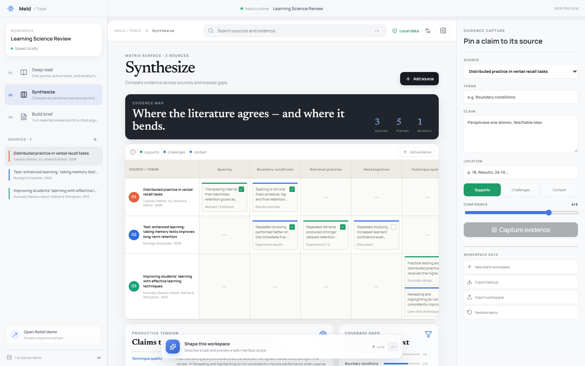

# Meld

**软件应该适应处境，而不是让人适应软件。**

Meld 是一个“可被代理安全改造”的界面运行时。应用先发布稳定的能力、数据与权限策略；用户或编码代理再把这些原语组合成差异巨大的界面配方。每次变化都可预览、审计和回退。

仓库现在包含两个完整案例：

- **Trace**：可实际使用的本地优先证据工作台，面向学习、文献研究、产品调研和决策写作。
- **Relief**：社区灾害响应参考应用，同一份数据可成为居民、现场志愿者和协调员的不同工作面。



## Trace 能做什么

Trace 让同一份来源与证据按照当前目标变成三种界面：

- **Deep read**：专注阅读一个来源，记录边栏笔记、原子证据与主动回忆问题。
- **Synthesize**：按主题横向比较来源，识别支持、反驳、背景证据和覆盖缺口。
- **Build brief**：将选中证据组合成可编辑论证，并导出带来源链接的 Markdown。

工作区自动保存在本地。可以创建空白项目、增删资料、记录证据、搜索筛选、导出/导入 JSON 备份，以及导出最终简报。无需注册或后端；API Key 仅用于可选的智能界面增强。

## 快速开始

```bash
npm install
npm run dev
```

打开 `http://localhost:5173`，默认进入 Trace。

- `/?mode=read`：精读界面
- `/?mode=synthesize`：证据矩阵
- `/?mode=brief`：写作简报
- `/?app=relief`：灾害响应参考应用

点击 **Reshape** 可输入“对比文献矛盾”“准备汇报”“为考试精读”等目标，界面会改变，但证据库保持不变。

## 桌面端与安全 AI 自定义

```bash
npm run desktop:dev       # 桌面端开发模式
npm run desktop:package   # 生成未封装应用
npm run desktop:make      # Windows 安装器或 macOS ZIP
```

桌面端设置面板可填写 OpenAI Responses API Key、模型和兼容接口地址。Key 由 Electron 主进程调用系统凭据能力加密保存，不会进入渲染页面、localStorage 或工作区导出文件。核心功能完全离线可用，API Key 只是可选增强。

AI 不会生成或执行 HTML、JavaScript、CSS。它只能返回经过严格 JSON Schema 约束的“界面配方”，选择既有模式、密度、强调色、证据筛选、来源排序和检查器状态。软件会再次本地校验，先展示预览，用户应用后也能一键撤销；底层证据数据不会被 AI 改写。

完整说明见 [桌面端与安全边界](docs/desktop.md) 与 [Agent 工作台设计](docs/workbench-design.md)。仓库内置 GitHub Actions，可分别在 Windows 与 macOS 原生环境生成安装包。

在左栏切换 Resident、Field crew、Coordinator，再点击 **Shape this view** 输入：

```text
I'm a field volunteer, one hand, patchy signal.
Make this calm for an older resident.
Prioritize medical needs in bright sunlight.
```

代理不会直接执行生成代码。它先生成结构化 patch，通过能力与角色校验后显示差异，用户确认后才应用，并可在 change ledger 中回退。

## 核心分层

1. **Capabilities**：应用允许做什么，以及谁能做。
2. **Shared state**：界面变化后仍保持一致的事实来源。
3. **Recipes**：由区块、层级、密度和情境组成的可移植界面文档。
4. **Patches**：可验证、可预览、可审计、可回退的配方变更。

详细设计见 [`docs/architecture.md`](docs/architecture.md)，产品判断见 [`docs/product-thesis.md`](docs/product-thesis.md)。

## 验证

```bash
npm run check
```

当前包含可直接使用的 Trace Web/Electron 应用、安全的真实模型适配器，以及 Relief 研究原型。跨设备同步仍在路线图中。

MIT License
